<p align="center">
  
</p>

Feed in a job description. Get a match score, a tailored ATS resume (`.md` / `.docx` / `.pdf`) and a cover note. **You** make the final call. Nothing is ever auto-submitted.

Built for Performance & Digital Marketing roles. Works fully offline with no API keys.

## How it works



## Quick start

```bash
git clone <your-repo-url> && cd ATS-Resume-creator-Automation
python -m venv .venv && source .venv/bin/activate   # Windows: .venv\Scripts\Activate.ps1
pip install -r requirements.txt
python -m src.cli check-env
```

1. Fill in `data/candidate-profile.json` (your single source of truth).
2. Ingest a job, review, decide:

```bash
python -m src.cli ingest --text "..." --title "Role" --company "Org"   # or --file jobs.csv / --url <link>
python -m src.cli review
python -m src.cli decide <APP_ID> apply --notes "via portal"           # apply | applied | save | reject
python -m src.cli report                                               # pipeline + skill-gap stats
```

Try it first: `python -m src.cli run-sample all`. Add `--force` to generate a resume below the score threshold.

## Scoring



Weights, thresholds and tool synonyms live in `config/scoring.yaml`. Weights must sum to `1.0`.

## Config

| File | Purpose |
|---|---|
| `data/candidate-profile.json` | Skills, experience, achievements, facts the system must never violate |
| `config/scoring.yaml` | Weights, thresholds, synonyms |
| `config/policy.yaml` | Human-in-the-loop rules, factuality, ATS formatting, page limits |
| `.env` | Optional keys and switches (below) |

```env
MIN_MATCH_SCORE=75        # auto-generate threshold
RESUME_STYLE=de           # de = German Lebenslauf (default) | us = US/international
GEMINI_API_KEY=           # optional: LLM-powered tailoring
OPENAI_API_KEY=           # optional
SUPABASE_URL=             # optional: persistent tracking (run supabase_schema.sql first)
SUPABASE_KEY=
TELEGRAM_BOT_TOKEN=       # optional: run alerts
TELEGRAM_CHAT_ID=
```

No Supabase? It falls back to in-memory tracking automatically.

## Automate

- **GitHub Actions:** `.github/workflows/scheduled-discovery.yml` runs daily and uploads review packages as artifacts.
- **Local:** point Task Scheduler or cron at `python -m src.cli ingest --file jobs/daily.csv`.

## Safety

- Human-in-the-loop only: `decide` is always yours.
- Strict facts only: no invented metrics, missing skills get flagged, negative constraints reject.
- Logs redact PII and never record API keys.

## Project layout

```
assets/    README animations      config/   scoring + policy
data/      profile + sample jobs  prompts/  LLM prompt templates
src/       cli, ingest, score, resume, tracker      tests/
```

Run tests: `pytest`

---

<sub>Full step-by-step guide: [`docs/GUIDE.md`](docs/GUIDE.md)</sub>
